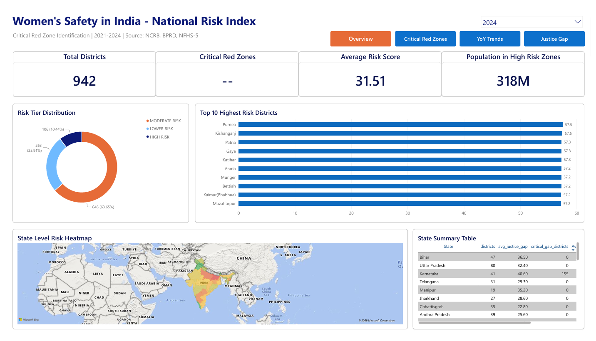
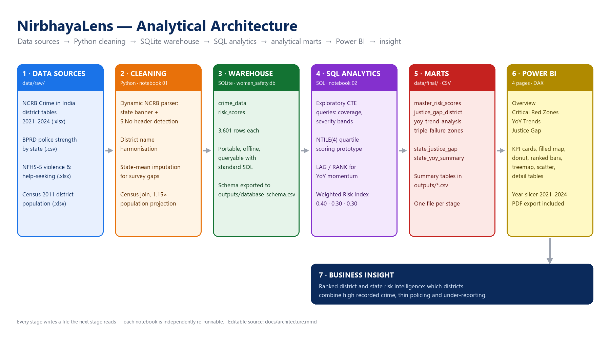
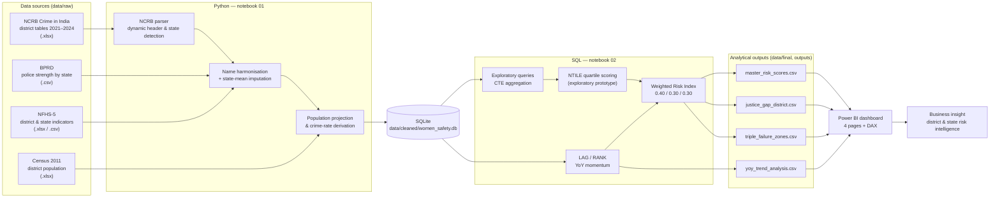
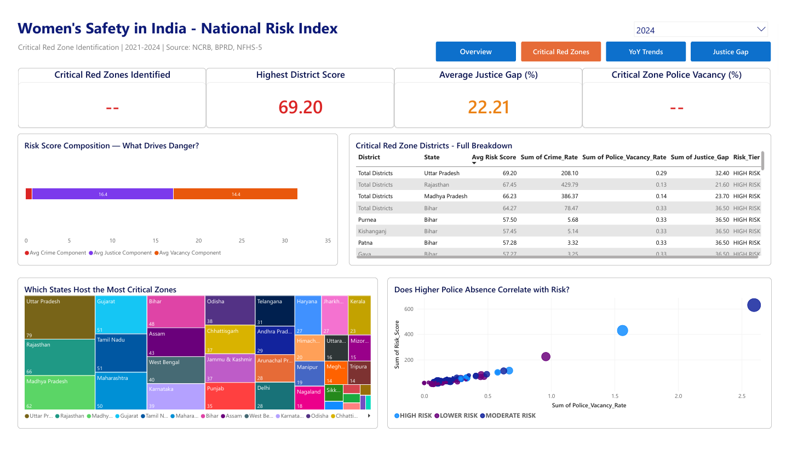
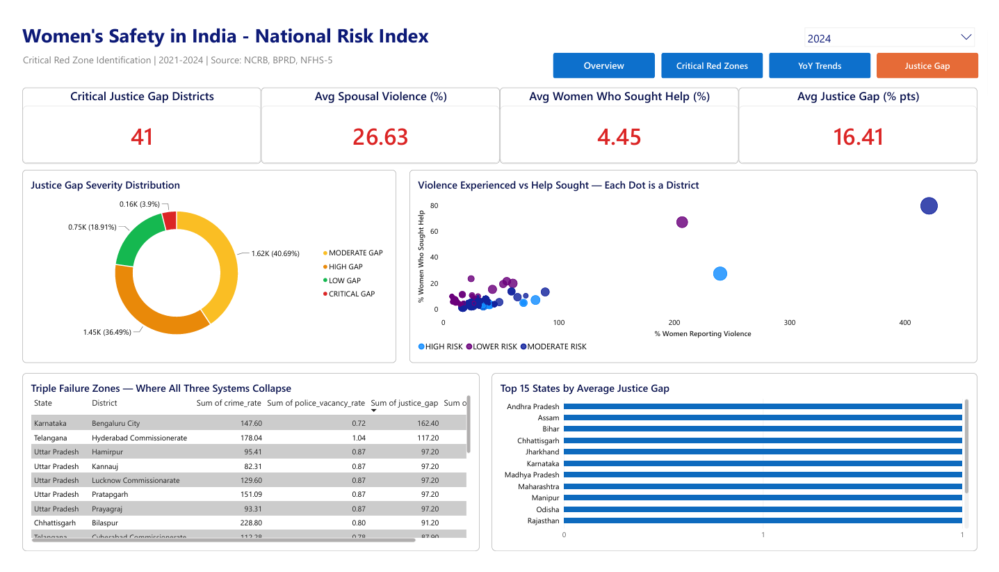
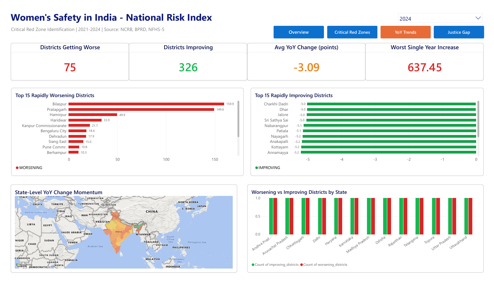

# NirbhayaLens — Women's Safety Intelligence & Urban Risk Analytics

**A district-level risk intelligence pipeline for India: fusing four government data sources into a transparent 0–100 safety index, then surfacing it through a four-page Power BI command centre.**

[](https://www.python.org/)
[](https://pandas.pydata.org/)
[](https://numpy.org/)
[](https://www.sqlite.org/)
[](https://jupyter.org/)
[](https://powerbi.microsoft.com/)
[](LICENSE)



---

## Table of Contents

1. [Overview](#1-overview)
2. [Problem Statement](#2-problem-statement)
3. [Project Objectives](#3-project-objectives)
4. [Features & Capabilities](#4-features--capabilities)
5. [Technology Stack](#5-technology-stack)
6. [Architecture](#6-architecture)
7. [Dashboard Screenshots](#7-dashboard-screenshots)
8. [Dataset Information & Attribution](#8-dataset-information--attribution)
9. [Data Processing Methodology](#9-data-processing-methodology)
10. [Exploratory Data Analysis](#10-exploratory-data-analysis)
11. [SQL Analysis](#11-sql-analysis)
12. [Python Implementation](#12-python-implementation)
13. [Statistical Methods](#13-statistical-methods)
14. [Dashboard Functionality](#14-dashboard-functionality)
15. [Key Findings](#15-key-findings)
16. [Installation](#16-installation)
17. [Execution](#17-execution)
18. [Repository Structure](#18-repository-structure)
19. [Dependencies](#19-dependencies)
20. [Limitations](#20-limitations)
21. [Future Enhancements](#21-future-enhancements)
22. [Credits & Acknowledgements](#22-credits--acknowledgements)
23. [Licence](#23-licence)

---

## 1. Overview

**NirbhayaLens** is an end-to-end analytics project on women's safety in India. It joins official crime records (NCRB), police staffing data (BPRD), household survey data on violence and help-seeking (NFHS-5) and district population (Census 2011) into a single district-year panel covering **2021–2024**.

On top of that panel it builds two original measures:

- a **weighted, min–max normalised Risk Index (0–100)** combining recorded crime, police vacancy and the justice gap;
- a **Justice Gap** metric — the distance between the share of women who report spousal violence and the share who ever seek help.

Those measures are then delivered as a **four-page Power BI dashboard** (National Overview, Critical Red Zones, YoY Trends, Justice Gap) and as reproducible CSV outputs for downstream analysis.

The analytical work happens in two Jupyter notebooks (Pandas cleaning + a SQLite/SQL analytics layer); Power BI is the presentation layer. Nothing in the pipeline depends on a live service — the repository is fully reproducible offline from the raw files committed under `data/raw/`.

> **Scope of this repository:** the analysis, notebooks, SQL logic, datasets and dashboard were originally authored by **Diyashi Roy**. This repository is a portfolio migration and presentation rebuild of that work — see [Credits](#22-credits--acknowledgements).

---

## 2. Problem Statement

Official crime statistics measure **reported** crime, not experienced harm. For crimes against women this gap is structural:

- A district can look "safe" simply because women there do not report.
- Police resourcing is recorded separately from crime, so under-policed districts are invisible in crime tables.
- Survey evidence of violence (NFHS-5) is never joined to administrative crime records at district level in routine reporting.

The result is that the districts where all three failures coincide — **high recorded crime, thin policing and severe under-reporting** — are precisely the districts least visible in any single dataset. NirbhayaLens exists to make that intersection explicit, auditable and ranked.

---

## 3. Project Objectives

| # | Objective | Delivered as |
|---|-----------|--------------|
| 1 | Build a clean district-year panel from four heterogeneous government sources | `data/cleaned/master_crime_data_clean.csv` (3,601 rows) |
| 2 | Quantify under-reporting as a measurable **Justice Gap** | `data/final/justice_gap_district.csv` |
| 3 | Construct a transparent 0–100 **Risk Index** with documented weights | `data/final/master_risk_scores.csv` |
| 4 | Rank districts and states, and flag the worst-performing tier | `outputs/top10_dangerous_districts_2024.csv`, `data/final/state_justice_gap.csv` |
| 5 | Measure year-over-year momentum per district | `data/final/yoy_trend_analysis.csv`, `state_yoy_summary.csv` |
| 6 | Identify **Triple Failure Zones** where all three systems collapse together | `data/final/triple_failure_zones.csv` |
| 7 | Communicate results to non-technical stakeholders | `powerbi/nirbhyalens_risk_dashboard.pbix` + PDF export |

---

## 4. Features & Capabilities

- **Multi-source fusion** — NCRB district crime tables (four annual workbooks), BPRD state police strength, NFHS-5 district indicators and Census 2011 population, harmonised on state/district keys.
- **Robust NCRB parsing** — the raw NCRB workbooks are multi-header, merged-cell reports; the cleaning notebook locates the `State:` marker and the `S. No` header row dynamically instead of hard-coding row offsets, so the same function runs across 2021–2024 files.
- **Custom Risk Index** — weighted 0–100 composite with per-year min–max normalisation, so districts are compared against their peers in the same year rather than across a shifting base.
- **Justice Gap metric** — `spousal_violence_pct − sought_help_pct`, with severity banding.
- **SQL analytics layer** — SQLite database plus a query notebook using CTEs, `NTILE`, `LAG` and `RANK()` window functions.
- **YoY momentum engine** — per-district change with `LAG()` and a direction classifier.
- **Triple Failure detection** — districts that simultaneously clear the crime, vacancy and justice-gap thresholds.
- **Four-page Power BI dashboard** — KPI cards, filled map, donut, ranked bars, decomposition bars, treemap, scatter plots, detail tables and custom page navigation.
- **Portable outputs** — every analytical table is exported to CSV, and the dashboard is also exported to PDF for reviewers without Power BI.

---

## 5. Technology Stack

| Layer | Technology | Used for |
|-------|-----------|----------|
| Language | Python 3.11 | Cleaning, imputation, risk scoring, exports |
| Data manipulation | pandas 2.1, NumPy 1.24 | Parsing Excel, joins, normalisation, aggregation |
| Notebook runtime | Jupyter | `01_data_cleaning.ipynb`, `02_SQL_Analysis.ipynb` |
| Database | SQLite (`sqlite3`, stdlib) | `data/cleaned/women_safety.db` analytical store |
| Query language | SQL — CTEs, window functions (`NTILE`, `LAG`, `RANK`), `CASE WHEN` | Risk tiers, YoY momentum, rankings |
| Visualisation | Power BI Desktop (`.pbix`) with DAX measures | Four-page interactive dashboard |
| Supporting libraries | openpyxl (Excel I/O), SciPy, Matplotlib, Seaborn | Declared project dependencies |
| Version control | Git, GitHub | Reproducibility and hosting |

---

## 6. Architecture



*Editable source: [`docs/architecture.mmd`](docs/architecture.mmd) (renders natively on GitHub).*



The pipeline is a straight line — **sources → Python cleaning → SQLite → SQL analytics → CSV marts → Power BI** — with no hidden services. Each stage writes a file that the next stage reads, which is what makes the notebooks re-runnable in isolation.

---

## 7. Dashboard Screenshots

All screenshots are captures of the actual `powerbi/nirbhyalens_risk_dashboard.pbix` report pages (2024 filter), not mock-ups.

### National overview


### KPI and metrics section


### Analytical visualisation



### Detailed drill-down



### Year-over-year trends (additional page)



---

## 8. Dataset Information & Attribution

| Source | Publisher | Files in this repo | Grain | Used for |
|--------|-----------|--------------------|-------|----------|
| **NCRB — Crime in India** (2021–2024) | National Crime Records Bureau, MHA | `data/raw/ncrb/<year>/*.xlsx` | District / state, annual | Recorded crimes against women, crime rate base |
| **Data on Police Organisations** | BPRD, MHA | `data/raw/police/police_strength_statewise.csv` | State, annual | Police vacancy rate |
| **NFHS-5** (2019–21) | IIPS Mumbai for MOHFW | `data/raw/nfhs/nfhs5_district_data.xlsx`, `nfhs5_state_data.csv` | District / state, survey round | Spousal violence %, help-seeking % |
| **Census of India 2011** | Office of the Registrar General | `data/raw/census/district_population_2011.xlsx` | District | Population base for per-capita rates |

**Attribution:** all datasets are published by Government of India agencies and remain subject to their own terms of use. They are redistributed here as committed source files for reproducibility only; the MIT licence on this repository covers **code and documentation**, not the underlying data. Cite the original publishers (NCRB, BPRD, IIPS/NFHS-5, ORGI) in any derived work.

---

## 9. Data Processing Methodology

Notebook `notebooks/01_data_cleaning.ipynb` builds the master panel:

1. **Header discovery.** NCRB workbooks stack title rows, merged state banners and sub-headers above the data. Rather than hard-coding offsets, the parser scans every row for a cell containing `State:`, forward-fills the state name, then finds the `S. No` row and slices everything below it.
2. **Column selection by position.** Columns are taken by index (district, murder, dowry death, abetment of suicide, cruelty by husband, kidnapping, rape) because NCRB header labels shift between annual editions; numeric coercion with `errors="coerce"` and zero-fill follows.
3. **Junk-row removal.** Numeric-only "district" rows (leftover sub-headers) are dropped; district names are stripped and upper-cased for joining.
4. **Population join.** Census 2011 district totals (`Level = DISTRICT`, `TRU = Total`) are matched on standardised district names; 2024 population is projected with a **1.15 growth factor**.
5. **Survey join & imputation.** NFHS-5 spousal-violence and help-seeking percentages are attached at district level; missing values are imputed with the **year + state mean** so no district is dropped from the index.
6. **Rate derivation.** `Crime_Rate` is total recorded violence per 100k of projected population; `Police_Vacancy_Rate` comes from BPRD strength versus sanctioned posts.
7. **Justice Gap.** `Spousal_Violence_Percent − Sought_Help_Percent`, clamped at zero.
8. **Export.** `data/cleaned/master_crime_data_clean.csv` (3,601 rows) → loaded into SQLite as `crime_data`.

**Risk Index construction (notebook 02, step 3.6):** each of the three dimensions is min–max normalised within the year, then combined as

```
Risk_Score = 100 × (0.40 × Crime_Rate_Norm
                  + 0.30 × Vacancy_Rate_Norm
                  + 0.30 × Justice_Gap_Norm)
```

and banded into tiers: `CRITICAL RED ZONE` ≥ 75, `HIGH RISK` 50–74.99, `MODERATE RISK` 25–49.99, `LOWER RISK` < 25.

---

## 10. Exploratory Data Analysis

The EDA answers four questions before any index is built (queries 1–6 in `02_SQL_Analysis.ipynb`):

- **Where is recorded crime highest?** Ranked district and state crime-rate tables establish the descriptive baseline.
- **How thin is policing?** Vacancy is bucketed into critical (≥40%), high (25–39%), moderate (10–24%) and low (<10%) bands and cross-tabulated against crime rate.
- **How large is the reporting gap?** Spousal violence versus help-seeking, ranked by gap.
- **Is coverage representative?** Districts and years covered per state are counted so thin states are flagged rather than silently averaged.

Verified coverage in the committed outputs: **2021–2024**, **36 states/UTs** in the 2024 slice, and a panel of roughly **929–979 district rows per year** after removing 36 state-aggregate rows per year.

---

## 11. SQL Analysis

SQLite is the analytical engine (`data/cleaned/women_safety.db`, tables `crime_data` and `risk_scores`, 3,601 rows each). The notebook demonstrates, with documented business rationale for each query:

| Technique | Where used | Purpose |
|-----------|-----------|---------|
| Multi-stage CTEs | Steps 3.3, 3.4 | Build a scored district table before ranking it |
| `NTILE(4) OVER (PARTITION BY Year)` | Step 3.3 | Equal-weight quartile scoring prototype (3–12 scale) |
| `LAG(...) OVER (PARTITION BY District ORDER BY Year)` | Step 3.4 | Year-over-year change per district |
| `RANK() OVER (...)` | Step 3.3 | National risk ranking |
| `CASE WHEN` banding | Steps 3.2, 3.3 | Vacancy severity, risk tiers, gap severity |
| `GROUP BY` aggregation | Steps 3.2, 3.5 | State summaries, coverage checks, national trend |

Step 3.3 is deliberately kept as an **exploratory NTILE prototype**; the production index in step 3.6 supersedes it with weighted min–max normalisation. Both are retained so the reasoning trail stays visible.

---

## 12. Python Implementation

| Notebook | Role | Key operations |
|----------|------|----------------|
| `notebooks/01_data_cleaning.ipynb` | Ingestion and cleaning | Dynamic header/state parsing, positional column extraction, name harmonisation, Census join, population projection, state-mean imputation, rate derivation, master CSV export |
| `notebooks/02_SQL_Analysis.ipynb` | Database, SQL and index | SQLite load and schema validation, six exploratory queries, NTILE prototype, LAG momentum, justice-gap deep dive, weighted Risk Index, tiering, CSV marts |

Supporting outputs are plain CSV so the results can be inspected without running anything: `outputs/database_schema.csv`, `outputs/national_trend_summary.csv`, `outputs/risk_summary_2024.csv`, `outputs/top10_dangerous_districts_2024.csv`.

> The notebooks reference absolute paths from the original author's machine (`C:\Users\diyas\...`). Set `BASE_DIR` at the top of each notebook to your clone location before running — see [Execution](#17-execution).

---

## 13. Statistical Methods

The project is descriptive and index-based; it deliberately does **not** claim inferential or causal results.

- **Min–max normalisation** per year, per dimension, to make heterogeneous units comparable.
- **Weighted composite index** (0.40 crime / 0.30 vacancy / 0.30 justice gap), with the weighting rationale documented in the notebook and README.
- **Quartile scoring (`NTILE`)** as an equal-weight exploratory alternative to the weighted index.
- **Pearson correlation** between the Risk Index and each component (computed in the analysis, see [Key Findings](#15-key-findings)).
- **Threshold banding** for tiers and severity labels.

No significance testing, sensitivity analysis or regression modelling is included — see [Limitations](#20-limitations).

---

## 14. Dashboard Functionality

`powerbi/nirbhyalens_risk_dashboard.pbix` — four pages with custom navigation buttons and a year slicer (2021–2024):

1. **Overview** — KPI cards (total districts, critical red zones, average risk score, population in high-risk zones), risk-tier donut, top-10 highest-risk districts, state-level filled map and a state summary table.
2. **Critical Red Zones** — risk-score composition bars that decompose the index back into its three weighted components, a full metric table per district, a state treemap of critical-zone counts, and a vacancy-versus-risk scatter testing the core thesis.
3. **YoY Trends** — top-15 worsening versus improving districts, state momentum map and a worsening/improving comparison chart, all driven by the `LAG` output.
4. **Justice Gap** — gap-severity donut, violence-versus-help-seeking scatter (one dot per district), Triple Failure Zones table and top-15 states by average justice gap.

An exported PDF (`outputs/nirbhyalens_dashboard.pdf`) mirrors the report for reviewers without Power BI Desktop.

---

## 15. Key Findings

All figures below are computed from the committed outputs (`data/final/*.csv`, `outputs/*.csv`) and are reproducible from them.

**1. The risk index never crosses the "critical" threshold.** Across 2021–2024 no real district reaches 75: the maximum score is **57.50** (Purnea, Bihar, 2024). The four-tier scheme therefore resolves into three populated tiers — in 2024, **99 HIGH RISK**, **629 MODERATE RISK** and **251 LOWER RISK** districts, with **0 CRITICAL RED ZONES**. This is why the "Critical Red Zones" KPI renders as `--` on the dashboard: it is a threshold mismatch in the design, not a data gap.

**2. The index is driven by structural capacity, not recorded crime.** Correlations across all district-year rows:

| Pair | Pearson r |
|------|-----------|
| Risk Score ↔ Police Vacancy Rate | **0.87** |
| Risk Score ↔ Justice Gap | **0.87** |
| Risk Score ↔ Crime Rate | **−0.02** |

Vacancy and the justice gap together account for almost all of the index's variance; recorded crime contributes essentially nothing. This is a real property of the 40/30/30 construction combined with the crime-rate distribution, and it is the single most important caveat when reading the rankings.

**3. Under-reporting is large and consistent.** Mean justice gap is **22.4 percentage points** (median 22.8, maximum 40.6) against a mean spousal-violence rate of **26.8%** and mean help-seeking of just **4.4%**. In other words, for every woman reporting violence in the survey, roughly six report ever seeking help. 155 district-year rows fall into the `CRITICAL GAP` band.

**4. The 2024 top of the table is concentrated in Bihar.** The ten highest-risk districts in 2024 are all Bihar districts (Purnea 57.50, Kishanganj 57.45, Patna 57.28, Gaya 57.27, Katihar 57.27, Araria 57.24, Munger 57.24, Bettiah 57.23, Kaimur 57.21, Muzaffarpur 57.19), sharing a state-level vacancy rate of 0.335 and a justice gap of 36.5 points.

**5. National averages are flat, not improving.** Mean risk score moves from **31.54 (2021)** to **31.36 (2024)** — a change of 0.18 points on a 0–100 scale. The YoY export classifies **135** district-years as worsening, **463** as improving and **2,317** as stable, so the improvement is localised rather than national.

**6. Triple-failure conditions exist but are rare.** Only **75** district-year rows satisfy all three thresholds simultaneously, concentrated in Uttar Pradesh, Karnataka and Telangana (e.g. Bengaluru City, Hyderabad Commissionerate, Bilaspur, Pratapgarh).

---

## 16. Installation

**Requirements:** Python **3.11** (the pinned pandas/NumPy versions predate 3.12 wheels), Git, and — for the dashboard only — Power BI Desktop.

```bash
git clone https://github.com/shreya-0417/NirbhayaLens---Women-s-Safety-Intelligence-Urban-Risk-Analytics.git
cd NirbhayaLens---Women-s-Safety-Intelligence-Urban-Risk-Analytics
```

```bash
python -m venv .venv

# Windows
.venv\Scripts\activate

# macOS / Linux
source .venv/bin/activate

pip install --upgrade pip
pip install -r requirements.txt
```

---

## 17. Execution

**1. Point the notebooks at your clone.** Both notebooks define an absolute `BASE_DIR` at the top; change it to your local path:

```python
BASE_DIR = r"<path-to-your-clone>"
```

**2. Run the cleaning pipeline.**

```bash
jupyter notebook notebooks/01_data_cleaning.ipynb
```

This reads `data/raw/**` and writes `data/cleaned/master_crime_data_clean.csv`.

**3. Run the SQL analytics pipeline.**

```bash
jupyter notebook notebooks/02_SQL_Analysis.ipynb
```

This rebuilds `data/cleaned/women_safety.db` (tables `crime_data`, `risk_scores`) and writes the analytical marts under `data/final/` plus the summary tables under `outputs/`.

**4. Open the dashboard.**

```bash
start powerbi/nirbhyalens_risk_dashboard.pbix   # Windows
open powerbi/nirbhyalens_risk_dashboard.pbix    # macOS
```

Refresh the data source if you re-ran the notebooks, then use the year slicer and page buttons. No Power BI? Open `outputs/nirbhyalens_dashboard.pdf`.

**Quick verification without Jupyter:**

```bash
python -c "import pandas as pd; d=pd.read_csv('data/final/master_risk_scores.csv'); print(d.shape, d.Risk_Tier.value_counts().to_dict())"
```

---

## 18. Repository Structure

```
NirbhayaLens---Women-s-Safety-Intelligence-Urban-Risk-Analytics/
├── data/
│   ├── raw/                     # Untouched government source files
│   │   ├── ncrb/{2021..2024}/   # NCRB Crime in India workbooks
│   │   ├── police/              # BPRD state police strength
│   │   ├── nfhs/                # NFHS-5 district & state indicators
│   │   └── census/              # Census 2011 district population
│   ├── cleaned/
│   │   ├── master_crime_data_clean.csv   # Master panel (3,601 rows)
│   │   └── women_safety.db               # SQLite: crime_data, risk_scores
│   └── final/                   # Analytical marts consumed by Power BI
│       ├── master_risk_scores.csv
│       ├── justice_gap_district.csv
│       ├── state_justice_gap.csv
│       ├── yoy_trend_analysis.csv
│       ├── state_yoy_summary.csv
│       └── triple_failure_zones.csv
├── notebooks/
│   ├── 01_data_cleaning.ipynb   # Ingestion, harmonisation, imputation
│   └── 02_SQL_Analysis.ipynb    # SQLite, SQL analytics, Risk Index
├── powerbi/
│   └── nirbhyalens_risk_dashboard.pbix
├── screenshots/                 # Dashboard captures used in this README
│   ├── dashboard-overview.png
│   ├── dashboard-kpis.png
│   ├── dashboard-analysis.png
│   ├── dashboard-details.png
│   └── dashboard-trends.png
├── docs/
│   ├── architecture.mmd         # Editable Mermaid source
│   └── architecture.png         # Exported diagram
├── outputs/
│   ├── database_schema.csv
│   ├── national_trend_summary.csv
│   ├── risk_summary_2024.csv
│   ├── top10_dangerous_districts_2024.csv
│   └── nirbhyalens_dashboard.pdf
├── CONTRIBUTING.md
├── CHANGELOG.md
├── LICENSE
├── NOTICE                       # Authorship attribution + data notice
├── requirements.txt
└── README.md
```

---

## 19. Dependencies

`requirements.txt` (pinned):

| Package | Version | Role |
|---------|---------|------|
| pandas | 2.1.0 | Data frames, joins, normalisation |
| numpy | 1.24.0 | Vectorised maths |
| matplotlib | 3.7.0 | Declared plotting dependency |
| seaborn | 0.12.0 | Declared statistical plotting dependency |
| openpyxl | 3.1.0 | Reading the NCRB/Census `.xlsx` files |
| sqlalchemy | 2.0.0 | Declared SQL toolkit dependency |
| jupyter | 1.0.0 | Notebook runtime |
| scipy | 1.11.0 | Declared scientific computing dependency |

SQLite support is built into Python's standard library (`sqlite3`). Power BI Desktop is a separate, free desktop install and is not a Python dependency.

---

## 20. Limitations

These are properties of the current implementation, stated so results are not over-read:

- **Threshold mismatch.** No district reaches the 75-point CRITICAL threshold, so the Critical Red Zones page and its KPIs are effectively empty in the current data. Either the tier thresholds or the index scaling needs recalibration.
- **The index is capacity-dominated.** With r ≈ 0.87 against vacancy and justice gap but ≈ 0 against crime rate, the ranking is close to a policing-and-reporting index. The 40/30/30 weights were chosen by judgement, not derived from sensitivity analysis.
- **Crime rate is small in magnitude.** The committed `Crime_Rate` values sit in single digits per 100k while a handful of districts (notably Delhi North) show values in the hundreds, which compresses the normalised crime component.
- **Aggregate rows survive into the marts.** 36 "Total Districts" rows per year (state aggregates) are present in `master_risk_scores.csv`; the dashboard filters some of them out, which is why on-page district counts (942) differ from raw row counts.
- **YoY export contains artefacts.** Some rows carry `prev_year == Year`, and state-aggregate rows appear alongside districts. Treat momentum figures as indicative; the dashboard's worst-year-increase KPI (637.45) reflects one such artefact.
- **Justice Gap assumes comparability.** The metric subtracts a help-seeking percentage from a spousal-violence percentage drawn from different NFHS-5 modules with different reference populations.
- **Population is projected, not observed.** 2024 population = Census 2011 × 1.15 flat factor; district-level growth is not modelled.
- **NFHS-5 is a 2019–21 survey** repeated across 2021–2024 rather than re-measured annually.
- **Imputation is simple.** Missing survey values use year + state means, which pulls districts toward their state average.
- **No inferential statistics.** No confidence intervals, significance tests, regression or causal claims are made.
- **Dashboard polish.** A few visuals render at incorrect scale (state comparison bars showing 1.0/0.0, state tables showing row-level rather than summed values) and some KPI cards display `--` when a tier is empty.

---

## 21. Future Enhancements

- Recalibrate tier thresholds against the observed score distribution, or rescale the index to use the full 0–100 range.
- Run a sensitivity analysis over the 40/30/30 weights and report rank stability.
- Exclude state-aggregate rows at the SQL layer so every mart is district-only.
- Repair the YoY join so `prev_year` always equals `Year − 1`, and re-derive the momentum KPIs.
- Normalise crime rate on a log scale to stop a few high-outlier districts compressing the distribution.
- Add a Python-based equivalent of the dashboard (Plotly/Dash) so the visuals are reproducible without Power BI Desktop.
- Publish a small data-quality report (row counts, null rates, unmatched district names) alongside the marts.

---

## 22. Credits & Acknowledgements

**Original analysis, notebooks, SQL logic, datasets and Power BI dashboard:** **Diyashi Roy** — [GitHub @diac04](https://github.com/diac04), [LinkedIn](https://www.linkedin.com/in/diyashi-roy-894811290/). The risk index design, justice-gap metric and four-page report are her work.

**Repository migration, rebranding, documentation, architecture diagram and presentation rebuild:** **Shreya** ([@shreya-0417](https://github.com/shreya-0417)).

**Data providers:** National Crime Records Bureau (Crime in India 2021–2024), Bureau of Police Research and Development (Data on Police Organisations), International Institute for Population Sciences (NFHS-5), Office of the Registrar General & Census Commissioner (Census 2011).

**Tools:** pandas, NumPy, SQLite, Jupyter, Power BI Desktop, Mermaid.

---

## 23. Licence

Released under the [MIT License](LICENSE). The original author permitted reuse of the analysis and code with attribution, which is preserved in [Credits](#22-credits--acknowledgements), in the licence file and in [NOTICE](NOTICE).

The MIT licence covers **code and documentation only**. The government datasets under `data/raw/` remain the property of their respective publishers and are included for reproducibility; the Power BI report and derived CSVs may be reused under the same terms as the code, with attribution to the original author.
